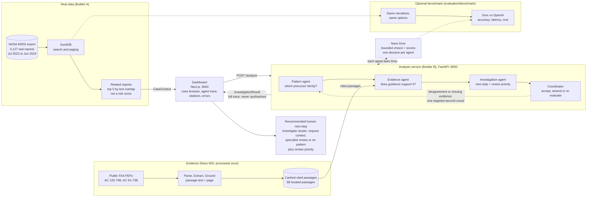

# NearMiss AI

Local aviation incident investigation prototype. See the [implementation plan](NearMissAI_Two_Person_Implementation_Plan.md) for the full scope and [shared contract](contracts.md) for the handoff between teammates.

## The problem

Aviation incident reports describe complex interactions between people, procedures and conditions, but an analyst reads them **one narrative at a time**:

- A single voluntary, unverified ASRS report rarely shows the **recurring pattern** behind it.
- The **procedural guidance** that applies sits in separate FAA PDFs, so checking it is manual.
- What the analyst needs is a defensible **next investigative step**, not a summary and never an accident prediction.

NearMiss AI is **analyst triage**: four agents each make a bounded [Nace Drex](https://console.nace.ai/docs) decision, read each other's findings, challenge weak evidence with page-cited FAA passages processed by Nace NDI, and recommend what a **human** should investigate next, with the whole decision trace visible.

## Architecture



Failures never become fake results: if Drex or NDI is unavailable the run is returned as `incomplete` with the real messages produced so far. The benchmark is separate from the swarm; see [evaluation/benchmark/README.md](evaluation/benchmark/README.md).

## Team boundaries

| Area | Owner | Purpose |
| --- | --- | --- |
| `data/`, `data_pipeline/`, `dashboard/` | Builder A (Codex) | ASRS data, retrieval, and Next.js UI |
| `service/`, `agents/`, `evidence/` | Builder B (Claude Code) | FastAPI, Drex agents, and NDI evidence |
| `evaluation/` | Builder A | Optional benchmark, after the core demo works |
| `contracts.md`, `tests/fixtures/` | Shared | Agree on changes before either side relies on them |

Use separate branches for implementation work. The `asrs_case_*.json` files in `tests/fixtures/` are real NASA ASRS case contexts. The older `*_mock.json` files are synthetic interface examples and must never be presented as real reports, NDI output, or Drex decisions.

## Builder A: local run

The official NASA ASRS CSV for incidents from July 2023 to June 2024 (5,127 reports) was downloaded and imported locally; its provenance and export recipe are in [the data manifest](data/manifest.md). Raw data and DuckDB files are excluded from Git. To reproduce on another machine, export the CSV from NASA as described there and save it to `data/asrs_jul2023_jun2024.csv`.

Use Python 3.11–3.14 (DuckDB wheels may lag the newest Python release):

```sh
python3.14 -m venv .venv14
.venv14/bin/pip install -r requirements-a.txt
.venv14/bin/python -m data_pipeline.asrs import data/asrs_jul2023_jun2024.csv --sample "NASA ASRS Database Online; incident dates July 2023 - June 2024; CSV exported 2026-11-14"
.venv14/bin/uvicorn data_pipeline.api:app --host 127.0.0.1 --port 8001
```

In another terminal:

```sh
cd dashboard/web
npm ci
npm run dev
```

Open `http://127.0.0.1:3000`. The Next.js dashboard reads the local Builder A API at `http://127.0.0.1:8001` and sends a real `CaseContext` to Builder B's local `POST /analyze` at `http://127.0.0.1:8000`. Override these defaults with server-side `DATA_API_URL` and `ANALYSIS_API_URL` if needed. The dashboard works as a case browser while Builder B's service is offline and shows that status explicitly. It displays only actual service responses; a prior live run is labeled when restored from browser storage. No API key is needed for Builder A. Keep Builder B's Nace key in local environment variables, never in source control.

The former Streamlit entry point at `dashboard/app.py` remains available for reference. Streamlit is no longer a Builder A dependency.

## Builder B: live integration

Install Builder B's dependencies into the same virtual environment and place a working `NACE_API_KEY` in a git-ignored root `.env` (see `.env.example`). Then prepare the public FAA guidance once and start the analysis API in a third terminal:

```sh
.venv14/bin/pip install -r service/requirements.txt
.venv14/bin/python -m evidence.ingest
.venv14/bin/uvicorn service.app:app --host 127.0.0.1 --port 8000
```

The frontend shows both service statuses. Its saved real-run buttons open the actual Drex/NDI traces documented in [live run notes](evaluation/live_runs.md); they are labeled as prior runs. Rerun a case with **Run collaborative analysis** to get fresh decisions. The strict cited Evidence Agent conflict scenario is still being evaluated; the saved second-round example is a Coordinator response to unresolved evidence.

Run the local real-data checks with `.venv14/bin/python -m unittest tests/test_builder_a.py -v`. They require the downloaded CSV and imported DuckDB file. The dashboard's live analysis path still needs Builder B's service for an end-to-end test.
